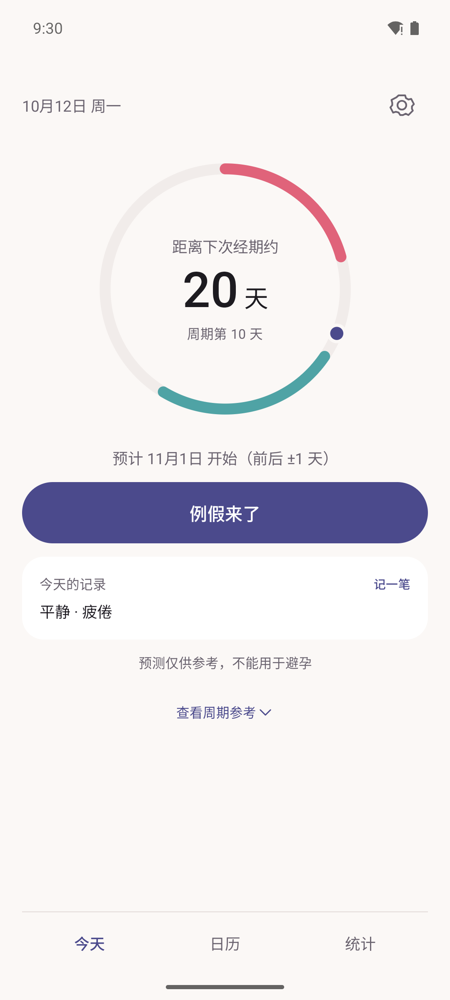
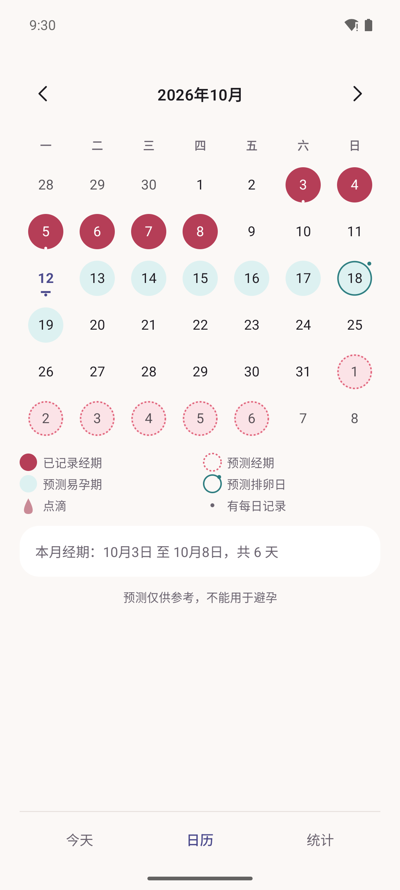
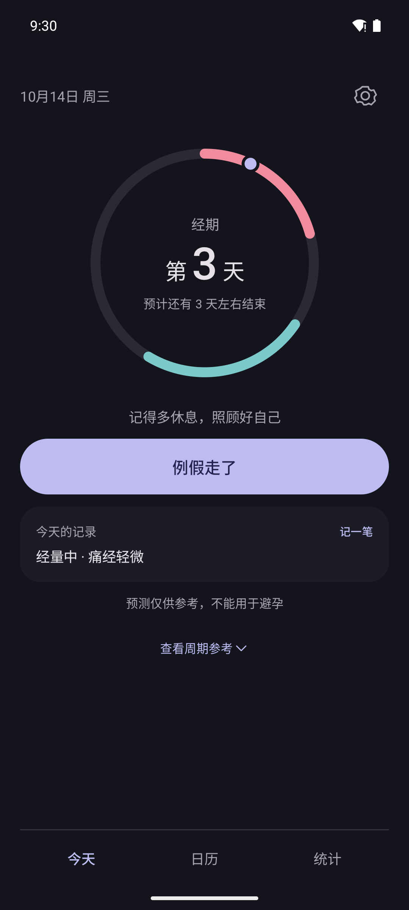

# 1.0.1 界面预览（未发布）

根据用户提供的月夜与潮汐示意调整。以下均为 Android API 35 模拟器实际运行截图，1080×2400、简体中文、100% 字号，**所有记录都是虚构示例数据**，没有同房记录。

| 浅色 · 今天 | 浅色 · 日历 | 深色 · 经期中 |
|---|---|---|
|  |  |  |

日期与预测数值来自虚构记录和实际预测引擎，因此与示意图中的例子不必相同。为展示同月的实际记录、易孕期与未来预测，浅色截图使用模拟器日期 2026-10-12，深色经期中截图使用 2026-10-14；走查完成后恢复真实时间。

- 首页：日期头、页面背景上的独立细圆环、随主题切换的主色按钮、简短每日摘要。
- 圆环：玫瑰色经期段、潮汐青易孕期段、月夜靛/浅紫的今日圆点；保持单个主数字。
- 日历：实心、虚线、描边等形状标记，图例默认可见；记录日期底色为白字对比度稍加深。
- 导航：文字选项与分隔线，保留选中语义、触区和系统导航栏边距。
- 大字号：状态改用自然高度文字，日历扩大单元格，内容可以滚动；完整真人 TalkBack 尚未验证。

另有 [每日记录](screenshots/03-daylog.png)、[统计](screenshots/04-stats.png)、[隐私与安全](screenshots/05-privacy.png)。

已发布版本仍为 [v1.0.0](https://github.com/xichugeek/Lunatide/releases/tag/v1.0.0)。本目录用于审阅 1.0.1，不替换 1.0.0 的下载与官网校验信息。
