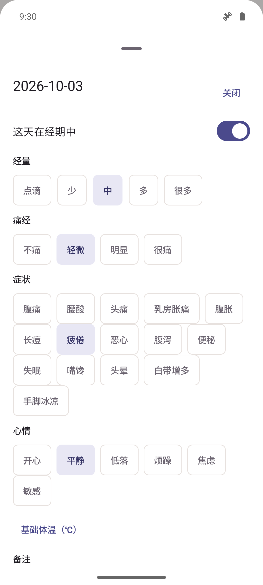
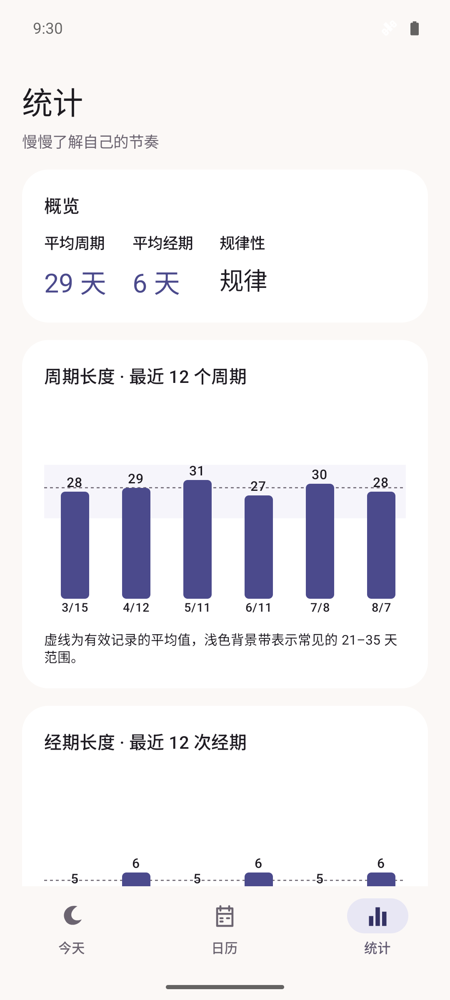
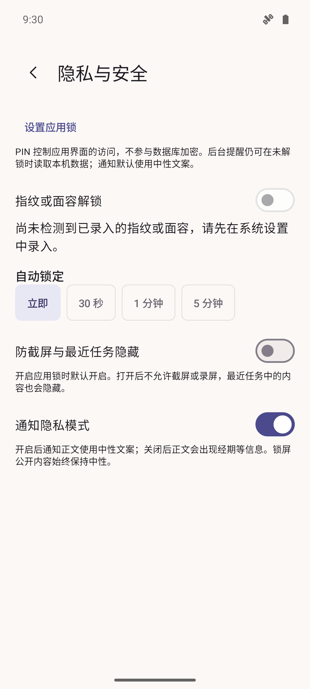

# 1. 标题块

PROJECT / 00X（编号由网站维护者填写）

月汐

Lunatide · Private Period Tracker

Android · Open Source · APK v1.0.0 · Offline · No Network

# 2. 项目简介

记录身体的节奏，本来可以是一件安静的小事。月汐为希望避开广告、社区干扰、强制注册和隐私担忧的人，提供一本只留在手机里的周期日记。

不用创建账号，打开就能记录。经期、每日感受与统计都在本机处理，应用没有网络权限，也没有服务器。暖白与月夜靛的界面，让今天的状态和下一步操作更清楚。

适合希望自己保管记录、愿意通过加密备份手动迁移数据的 Android 用户。预测只作为参考，不能用于避孕，也不能代替医生诊断。

# 3. 实际截图

Android 模拟器实际运行，简体中文、浅色，**所有截图均为虚构示例数据**。

标题与英文对应文案见 screenshots/captions.json。

# 4. 下载与正式版本

以下信息由真实签名构建生成。下载链接在维护者发布对应 GitHub Release 后生效。

- 版本：1.0.0（versionCode 10000）
- APK 文件：Lunatide-v1.0.0.apk
- 文件大小：10118356 字节
- APK SHA-256：77e0902292ec9304619b0f31d9cf492a50e4556675c44258b5076d4e5414a39b
- 签名证书 SHA-256：4d4957412cedc56e24be8fec7061a1f83e9e1061cf3a97dea5965f0231a10676
- 构建源码提交：663d0d844fa3d8bbe5efbf11a570ac1b869d331e
- 构建时间：10/26/2026 09:01:03
- 下载：https://github.com/xichugeek/Lunatide/releases/download/v1.0.0/Lunatide-v1.0.0.apk
- Release Notes：https://github.com/xichugeek/Lunatide/releases/tag/v1.0.0
- SHA256 文件：https://github.com/xichugeek/Lunatide/releases/download/v1.0.0/Lunatide-v1.0.0.apk.sha256
- 仓库：https://github.com/xichugeek/Lunatide

# 5. 核心能力

- 一键记录经期开始与结束，支持撤销和更改日期。
- 日历展示实际记录、虚线预测、易孕期与排卵日参考。
- 自动保存每日经量、痛经、症状、心情、体温和备注。
- 周期与经期长度图表、症状统计和周期历史。
- 五种本地提醒，默认中性通知与锁屏隐私内容。
- 独立 PIN、可选指纹/面容、防截屏。
- 密码加密备份、覆盖/合并恢复、CSV 导出。
- 中文与英文、浅色与深色、可调记录项。

# 6. 隐私设计

应用没有网络权限，不注册账号，不含广告、埋点、崩溃上传或第三方推送 SDK。你可以在系统设置的应用权限中查看；源码与构建的 verifyPrivacy 检查也可自行审阅。

健康记录使用 SQLCipher 加密，数据库随机口令由 Android Keystore 保护。系统云备份和设备迁移全部禁用。通知默认使用中性文案；锁屏公开内容始终中性。开源代码、依赖清单及政策均在仓库中。

# 7. 项目架构

Compose UI → ViewModel → Repository → Room + SQLCipher（本机）

设置使用私有 DataStore，后台本地提醒使用 WorkManager。没有服务器、账号系统或远程同步接口。

# 8. 安装与升级

需要 Android 8.0 或以上。首次安装 APK 时，按系统提示允许当前来源安装应用。升级时直接覆盖安装，不要先卸载。

卸载会删除本机记录。卸载或换机前在「设置 → 数据与备份」导出加密备份，记住备份密码；密码无法找回。月汐不会自动检查更新，请自行查看官网或 GitHub。

# 9. 从源码到上线

1. 下载正式 APK，或克隆开源仓库。
2. 用 Android Studio 打开项目并安装所需 SDK/JDK。
3. 运行到设备，执行隐私检查、测试与构建。
4. 自行生成并保管签名密钥，再按发布指南校验和打包。

新手指南：https://github.com/xichugeek/Lunatide/blob/main/docs/BUILD_FROM_SOURCE.md

发布指南：https://github.com/xichugeek/Lunatide/blob/main/docs/ANDROID_RELEASE.md

# 10. 当前范围与限制

没有云同步，换机需要手动备份。PIN 是界面锁，数据库加密依赖系统 Keystore；已 Root、被攻破或已被他人解锁的手机保护有限。防截屏不能阻止外部相机拍摄。

预测仅供参考，不能用于避孕。部分系统可能延后或拦截后台提醒，不保证精确到分钟。目前提供中文和英文。设备覆盖与未验证项目见仓库 Agent/PROGRESS.md。

# 11. 技术栈

Kotlin、Jetpack Compose、Material 3、Room、SQLCipher、DataStore、WorkManager、Hilt。应用使用 MIT 许可证，依赖许可见 THIRD_PARTY_NOTICES.md。

# 12. 项目链接

- GitHub：https://github.com/xichugeek/Lunatide
- Releases：https://github.com/xichugeek/Lunatide/releases
- 隐私政策：https://github.com/xichugeek/Lunatide/blob/main/PRIVACY.md
- 安全说明：https://github.com/xichugeek/Lunatide/blob/main/SECURITY.md
- 新手指南：https://github.com/xichugeek/Lunatide/blob/main/docs/BUILD_FROM_SOURCE.md
- 发布指南：https://github.com/xichugeek/Lunatide/blob/main/docs/ANDROID_RELEASE.md
